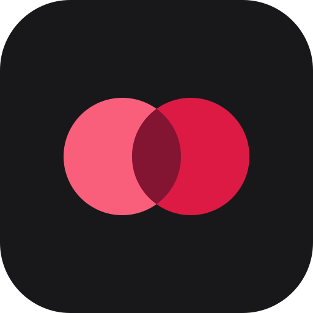

<div align="center">
  <a href="https://docs.cherry.al/">
    <picture>
      <source media="(prefers-color-scheme: dark)" srcset=".github/assets/cherry-mark-dark.svg" />
      
    </picture>
  </a>

  <h1>cherry docs</h1>

  <p><strong>The documentation site for cherry 2.0.</strong></p>

  <p>
    Guides and component reference for <a href="https://github.com/cherry-design-system/react"><code>@cherry-design-system/react</code></a>,<br />
    with the 1.x (<code>cherry-styled-components</code>) docs kept as a version.
  </p>

  <p>
    <a href="https://docs.cherry.al/">Docs</a> ·
    <a href="#structure">Structure</a> ·
    <a href="#write">Write</a> ·
    <a href="#develop">Develop</a> ·
    <a href="https://github.com/cherry-design-system/react">cherry</a>
  </p>
</div>

## Structure

```text
docs/
├── index.mdx, installation.mdx, ...   # v2 guide (default version, unprefixed URLs)
├── components/                        # v2 component reference: /components/<name>
└── v1/                                # 1.x docs, frozen: /v1/...
versions.json                          # version switcher: v2.0 (default), v1.x
theme.json                             # colors and logo for light and dark
config.json                            # site name, description, URL, preview image
links.json                             # footer links
public/                                # logos, favicon, icon, preview image
nextjs-app/                            # generated by Doccupine, gitignored
```

The site is built with [Doccupine](https://docs.doccupine.com): MDX in `docs/` becomes a Next.js site with search, an MCP server and `llms.txt`.

## Write

- **Source of truth.** Props, defaults and tokens come from the [cherry source](https://github.com/cherry-design-system/react) and its generated `skills/cherry-react/references/`. Never document a prop you have not seen there.
- **Frontmatter.** Every page sets `title`, `description`, `date`, `category`, `categoryOrder`, `order`, `navIcon` and `categoryIcon`. Component pages also set `section: "Components"`.
- **Previews.** Component pages open with a light and a dark iframe from `https://v2.cherry.al/preview/<id>?theme=light|dark`, at least 420px tall. 1.x pages use `v1.cherry.al`.
- **Code blocks.** Always give a language (`tsx`, `css`, `bash`, `text`).
- **Versions.** Edit the docs root for the current release. `docs/v1/` is frozen; its internal links start with `/v1`.

## Develop

```bash
pnpm install
npx doccupine watch --port 3000   # generate nextjs-app/ and run the dev server
npx doccupine build               # generate nextjs-app/ once
cd nextjs-app && pnpm install && pnpm build
```

`nextjs-app/` is regenerated from `docs/` and the JSON files on every run, so never edit it by hand. After a Doccupine upgrade, delete it and generate again: the generator does not remove files a newer template no longer uses.

To open the dev server from another host (a LAN IP or a Tailscale name), list it in `ALLOWED_DEV_ORIGINS` in `nextjs-app/.env`.
