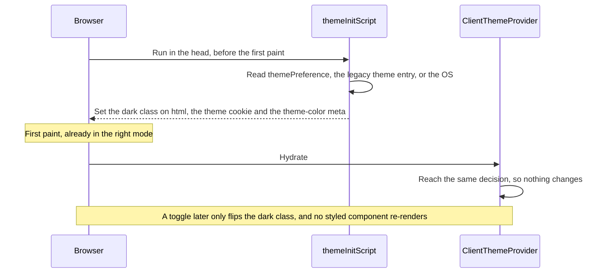

# Dark Mode

Cherry provides built-in support for dark mode. Pass the `themeDark` prop to the `CherryThemeProvider` component:

```tsx
import {
  CherryThemeProvider,
  theme,
  themeDark,
} from "cherry-styled-components";

export default function App({ children }) {
  return (
    <CherryThemeProvider theme={theme} themeDark={themeDark}>
      {children}
    </CherryThemeProvider>
  );
}
```

Without `themeDark` the page stays light, and toggling does nothing.

## How it works

The provider turns your two theme objects into one theme for both modes, whose colors and shadows are CSS variables: the light values on `:root`, the dark ones on `:root.dark` (see [Theming through CSS variables](/v1/code/theme#theming-through-css-variables)). The mode is the `dark` class on `<html>`.

A switch flips that class and the browser repaints. No styled component renders again, and the page changes at once instead of fading control by control: for the frame that paints the switch, a `.theme-switching` class on `<html>` turns CSS transitions off. Only components that read [`useColorMode()`](#usecolormode) or [`useResolvedTheme()`](#real-color-values) render again.

## How the mode is chosen

The visitor's preference is `"light"`, `"dark"` or `"system"`. Cherry picks the mode in this order:

1. An explicit choice, stored in `localStorage` as `themePreference` (`"light"`, `"dark"` or `"system"`).
2. Else a `theme` entry in `localStorage`, which Cherry wrote before 0.3 when the visitor toggled, so it still counts as their choice.
3. Else the OS setting (`"system"`), followed live: changing the OS appearance switches the page while it is open.

The mode in force is mirrored to the `theme` cookie, for server code that wants it (see [resolveTheme](#resolvetheme)). The cookie only decides the mode where `localStorage` is blocked, since it is then the only thing that keeps a choice.

## Manual Theme Toggle

The easiest way to let users switch modes is the built-in [ThemeToggle](/v1/code/theme-toggle) component. It calls `toggleTheme()` from `ThemeContext`, which switches to the other mode and stores it as the visitor's choice:

```tsx
import { ThemeToggle } from "cherry-styled-components";

export default function Header() {
  return (
    <header>
      <ThemeToggle />
    </header>
  );
}
```

To add a keyboard shortcut, set the `$shortcut` prop. While the toggle is mounted, <kbd>Command</kbd> + <kbd>Shift</kbd> + <kbd>L</kbd> (<kbd>Ctrl</kbd> + <kbd>Shift</kbd> + <kbd>L</kbd> on Windows) flips the mode, using the same `toggleTheme` as a click:

```tsx
<ThemeToggle $shortcut />
```

For a custom control, read the setters from `ThemeContext`:

- `toggleTheme()` - switches to the other mode and remembers it.
- `setPreference(preference)` - picks `"light"`, `"dark"` or `"system"` (follow the OS) and remembers it.

Both store the choice in `localStorage` and keep the `dark` class and the `theme` cookie in sync. The context value never changes, so reading it does not re-render a component when the mode switches:

```tsx
import { Button, Flex, ThemeContext } from "cherry-styled-components";
import { useContext } from "react";

export default function AppearanceMenu() {
  const { setPreference } = useContext(ThemeContext);
  return (
    <Flex $gap={10}>
      <Button $outline onClick={() => setPreference("light")}>Light</Button>
      <Button $outline onClick={() => setPreference("dark")}>Dark</Button>
      <Button $outline onClick={() => setPreference("system")}>System</Button>
    </Flex>
  );
}
```

## useColorMode

`useColorMode()` returns the mode in force, the visitor's preference, and the same two setters:

```tsx
useColorMode(): {
  mode: "light" | "dark";
  preference: "light" | "dark" | "system";
  toggleTheme: () => void;
  setPreference: (preference: "light" | "dark" | "system") => void;
}
```

A component that calls it renders again when the mode switches, so read it only for what CSS cannot do, such as marking the active option in a menu or picking an image per mode. A color that differs by mode belongs in a theme token, a `:root.dark &` rule or [`modes()`](#styles-that-differ-by-mode).

```tsx
"use client";
import { useColorMode } from "cherry-styled-components";

export default function Logo() {
  const { mode } = useColorMode();
  return ;
}
```

## Real color values

Inside styled components, theme colors are CSS variables. Code that hands a theme color to something CSS does not style (a canvas, a chart library, a code editor theme, a JavaScript color library) needs the real value instead. `useResolvedTheme()` returns the theme with real values for the mode in force, plus an `isDark` flag, and every mode token filled in:

```tsx
"use client";
import { useEffect, useRef } from "react";
import { useResolvedTheme } from "cherry-styled-components";

export default function Swatch() {
  const ref = useRef<HTMLCanvasElement>(null);
  // Real values: theme.colors.primary is a hex, not a CSS variable
  const theme = useResolvedTheme();

  useEffect(() => {
    const context = ref.current?.getContext("2d");
    if (!context) return;
    context.fillStyle = theme.colors.primary;
    context.fillRect(0, 0, 40, 40);
  }, [theme]);

  return <canvas ref={ref} width={40} height={40} />;
}
```

Like `useColorMode()`, it renders its component again when the mode switches.

## Styles that differ by mode

Since the theme no longer carries `isDark`, a style cannot branch on the mode in JavaScript. There are three ways to write a style that differs by mode:

- A **mode token** on the theme (`accent`, `link`, `onFilled`, `primaryTint*`, `shadows.toast`), when many styles share the color. See [Mode tokens](/v1/code/theme#mode-tokens).
- A **`:root.dark &` rule**, for a block of declarations only dark mode needs.
- **`modes()`**, for one-off choices. It wraps a styled interpolation written against `theme.isDark`, runs it once as light and once as dark, and emits CSS that follows the mode, so most existing `isDark` branches migrate by wrapping them:

```tsx
import styled from "styled-components";
import { modes } from "cherry-styled-components";

const Card = styled.div`
  border: solid 1px
    ${modes(({ theme }) =>
      theme.isDark ? theme.colors.gray : theme.colors.grayLight,
    )};
`;
```

When the interpolation returns a value (a color, a length, a shadow), `modes()` emits one value that switches with the mode. When it returns a `css` block with the same shape in both modes, it emits one block with a switching value in each slot that differs. Otherwise it emits a `:root.dark &` rule (or `:root:not(.dark) &` for a block only light mode needs).

`modeValue(light, dark)` is the plain-CSS form: one CSS value that is `light` under `:root` and `dark` under `:root.dark`. Any value type works, and it is server-safe:

```tsx
import styled from "styled-components";
import { modeValue } from "cherry-styled-components";

const Hero = styled.section`
  background-image: ${modeValue("url(/hero.jpg)", "url(/hero-dark.jpg)")};
`;
```

<Callout type="info">
  `modeValue()` relies on empty CSS custom properties, which the providers declare in their own `<style data-cherry-theme>` element. It works anywhere under a Cherry provider.
</Callout>

## Pinning a mode

Pass `$mode` to either provider to show one mode whatever the visitor's preference, for example on a page that is always dark. Nothing is stored, and toggling does nothing while it is set:

```tsx
<CherryThemeProvider theme={theme} themeDark={themeDark} $mode="dark">
  {children}
</CherryThemeProvider>
```

## Flash-Free Dark Mode with SSR

In a server-rendered app (e.g. Next.js App Router), the server cannot know the visitor's preference, which lives in their browser. Cherry closes that gap with a blocking script in the document `<head>`: `themeInitScript` makes the same decision as the provider and sets the `dark` class before the first paint, on every load. Nothing is hidden, and the colors never depend on the server render, since they come from the CSS variables.



Use `ClientThemeProvider` in the root layout, with the script in `<head>` and the app wrapped in `StyledComponentsRegistry`, the SSR style registry introduced in [Installation](/v1/code/installation). `themeInitScript` is exported from a server-safe module, so it can be rendered in a server component:

<Code title="app/layout.tsx" language="tsx" code={`// Server component
  import { StyledComponentsRegistry } from "cherry-styled-components/next";
  import { ClientThemeProvider, themeInitScript } from "cherry-styled-components";
  import { theme, themeDark } from "./theme";

  export default function RootLayout({ children }) {
    return (
      <html lang="en" suppressHydrationWarning>
        <head>
          <script dangerouslySetInnerHTML={{ __html: themeInitScript }} />
        </head>
        <body>
          <StyledComponentsRegistry>
            <ClientThemeProvider theme={theme} themeDark={themeDark}>
              {children}
            </ClientThemeProvider>
          </StyledComponentsRegistry>
        </body>
      </html>
    );
  }`} />

`suppressHydrationWarning` on `<html>` tells React that the `dark` class the script adds is expected.

`$initial` is optional. It only sets the mode `useColorMode()` reports during the server render (and hydration), which defaults to `"light"`; the colors do not depend on it. Pass the `theme` cookie's value when components read `useColorMode()` and you want their server HTML to match a returning visitor:

```tsx
import { cookies } from "next/headers";

const cookieTheme = (await cookies()).get("theme")?.value;

<ClientThemeProvider
  theme={theme}
  themeDark={themeDark}
  $initial={cookieTheme === "dark" ? "dark" : "light"}
>
  {children}
</ClientThemeProvider>;
```

To have that cookie on a first visit in Chrome, opt into color-scheme client hints in your middleware:

<Code title="middleware.ts" language="ts" code={`res.headers.set("Accept-CH", "Sec-CH-Prefers-Color-Scheme");
res.headers.set("Vary", "Sec-CH-Prefers-Color-Scheme");
res.headers.set("Critical-CH", "Sec-CH-Prefers-Color-Scheme");

const hint = req.headers.get("Sec-CH-Prefers-Color-Scheme");
if (!req.cookies.get("theme")?.value && hint) {
  res.cookies.set("theme", hint === "dark" ? "dark" : "light", {
    path: "/",
    maxAge: 60 * 60 * 24 * 365,
    sameSite: "lax",
  });
}`} />

### createThemeInitScript

`themeInitScript` is `createThemeInitScript()` with the default options. The script also writes the `<meta name="theme-color">` tag for the mode, so browser chrome that tints from it (the Safari tab bar, Android Chrome's toolbar) matches the page from the first paint. By default it uses Cherry's `light` token: white in light mode, black in dark mode.

Build your own script with `createThemeInitScript({ themeColor })`, where `themeColor` is `{ light, dark }` (the values of the token the provider's `$themeColor` tracks) or `false` to leave the meta tag alone:

```tsx
import { createThemeInitScript } from "cherry-styled-components";

// For a provider with $themeColor="primary"
const themeInitScript = createThemeInitScript({
  themeColor: { light: "#4d6f8b", dark: "#6198C6" },
});
```

<Callout type="note">
  Cherry's default `theme` and `themeDark` objects come from a `"use client"` module, so in a server component they are client references, not values. Pass literal values to `createThemeInitScript`, or import them from a theme module of your own that does not import Cherry's defaults. `createThemeVariables`, `modeValue`, `createThemeInitScript`, `themeInitScript` and `resolveTheme` are all server-safe.
</Callout>

### resolveTheme

Server code that needs the theme object for the visitor's last mode (for example `generateViewport` for the initial `theme-color`) can resolve the `theme` cookie with `resolveTheme(cookieValue, theme, themeDark?)`. It returns `themeDark` when the cookie is `"dark"` and a dark theme is given, else `theme`:

```ts
import { resolveTheme } from "cherry-styled-components";
import { theme, themeDark } from "./theme";

const active = resolveTheme(cookieTheme, theme, themeDark);
```

### $themeColor and $globalStyles

`ClientThemeProvider` keeps a `theme-color` meta tag in sync with the mode so browser chrome (like the iOS Safari status bar) matches the page. Point `$themeColor` at the theme color your page background uses (default `"light"`), or pass `false` to disable. If you change it, give `createThemeInitScript` the same token's values so the first paint matches too:

```html
<ClientThemeProvider
  theme={theme}
  themeDark={themeDark}
  $themeColor="tertiaryLight"
>
```

If your app ships its own global styles, pass `$globalStyles={false}` and render them as a child so Cherry's defaults don't compete with yours.

`CherryThemeProvider` is `ClientThemeProvider` without the `theme-color` meta sync (`$themeColor={false}`). It takes `theme`, `themeDark` and `$mode`, and always renders Cherry's global styles.

## Client-only apps

In a client-only app there is no server render, but the provider applies the mode in an effect, after React's first render. To have the first paint already in the right mode, run `themeInitScript` before you render the app:

<Code title="src/main.tsx" language="tsx" code={`import { themeInitScript } from "cherry-styled-components";

  const init = document.createElement("script");
  init.textContent = themeInitScript;
  document.head.appendChild(init); // an inline script runs as soon as it is inserted

  // ...then createRoot(...).render(<App />)`} />

<Button href="https://github.com/cherry-design-system/styled-components/blob/main/src/lib/styled-components/client-theme-provider.tsx" icon="code" iconPosition="left">
  View Source
</Button>
